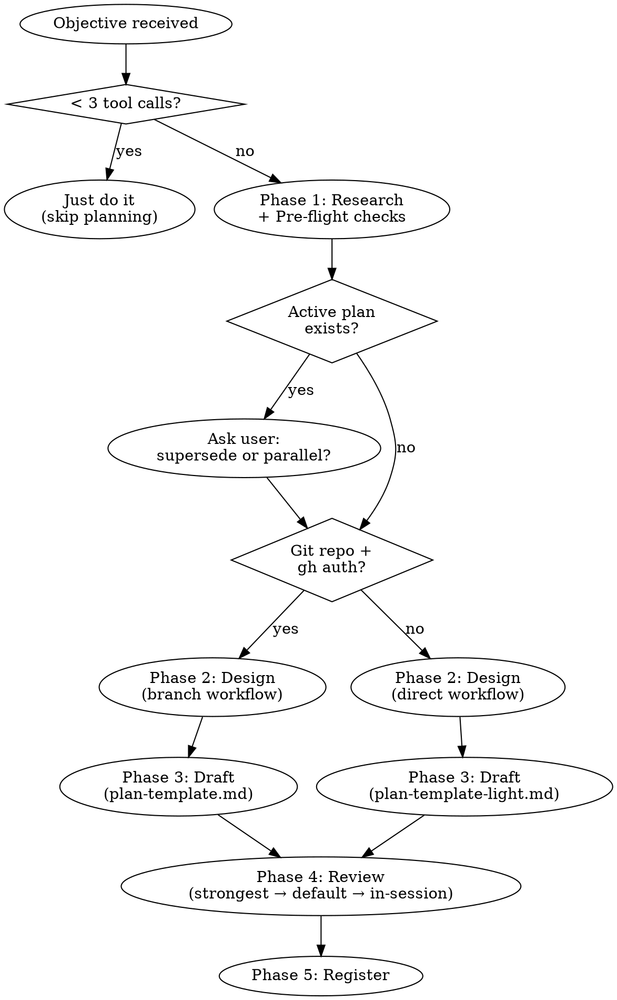

# Blueprint — Construction Plan Generator

Create a construction plan for a multi-step engineering task. Derive a short task name `<task>` from the one-line objective (used for the file and branch names).

**Core principle**: The plan's only reader is an agent with zero prior context. Every line must serve cold-start execution, not human reporting.

Example: "plan the migration of the database to PostgreSQL" → `docs/plans/migrate-database-to-postgresql.md`

## Prerequisites

- **Recommended**: git and an authenticated GitHub CLI (`gh`) for the full branch/PR/CI workflow. Without them, use direct mode.
- **Optional**: strongest-tier model and a CLI that can start sub-agents (better review).

## Decision Flow

## Phase 1 — Research

Gather the minimum context for sound design decisions.

0. **Pre-flight checks** — run all before planning. On failure, degrade gracefully or stop and ask; never guess.
   - `git rev-parse --is-inside-work-tree`: false → workflow mode "direct"; skip the other git checks.
   - `gh auth status`: fails → warn the user, mode "direct" (no PR/CI gates). Several accounts → list them and ask which to use before any remote operation.
   - `git config user.name` and `git config user.email`: either unset → **stop and ask**. Never auto-configure git identity; wrong attribution is permanent.
   - `git remote -v`: empty → warn the user, mode "direct" (PR/CI need a remote). Otherwise record the URL protocol (SSH or HTTPS); do not switch it.
   - **Default branch**: run `git symbolic-ref refs/remotes/origin/HEAD 2>/dev/null | sed 's@^refs/remotes/origin/@@'`. If that fails, run `git remote show origin 2>/dev/null | awk '/HEAD branch:/ {print $NF}'`. Store the result as `{default-branch}`. If both fail, use `main` and log the fallback in the plan's Design Decisions. Avoid `git remote set-head --auto`: it changes local refs and needs the network. Use `{default-branch}` throughout the plan; never hardcode `main`.

1. Read the project's `AGENTS.md` or `CLAUDE.md`, README, and package.json (or equivalent entry point).
2. Read `docs/plans/`; do not duplicate or contradict active plans (`Status: active`).
3. Scan source: directory structure, key modules, dependency graph, test setup.
4. If the objective is ambiguous, **ask targeted clarifying questions**. Never guess intent.

Output a 5-10 line context summary, then go to Phase 2 without asking for confirmation.

## Phase 2 — Design

Make architecture and sequencing decisions.

1. Break the objective into steps, each one PR's worth. A step is one-PR sized when (a) a reviewer can understand the full diff in one session, (b) it changes ≤15 files, (c) one sentence describes its intent. Split any step that fails. Target 3–12 steps. Two non-trivial steps (multiple files, CI requirements) are acceptable; do not split artificially. Over 12 steps → sequential plans, one coherent milestone each.
2. For each step, decide:
   - Can it run parallel to other steps? → draw dependency edges.
   - Does it modify shared files? → serial with other steps touching them.
   - Is it risky (large moves, entry point rewrites, breaking changes)? → prefer main-tree with an explicit rollback strategy. Worktree isolation is unreliable for sub-agents; use it only for genuinely destructive or exploratory steps where main-tree rollback is insufficient.
   - Model tier, mapped to the models your CLI offers:
     - **strongest**: architecture decisions touching 3+ modules, breaking-change risk assessment, review and audit, steps costly to reverse if wrong.
     - **default**: implementation, file moves, tests, config, mechanical refactors, search-heavy tasks.
     - Never assign fast/lightweight models: too little reasoning for autonomous execution.
     - Each step's `**Agent**:` field names the tier; start sub-agents on the matching model.
3. Assign Size (S/M/L) per step by scope, complexity, and risk. Judgment call, no formula.
4. List invariants: properties that hold after every step (e.g., build passes, no SDK leak into core).
5. List risks and a rollback strategy per step.
6. Record key design decisions with rationale ("chose A because B fails under X, C adds unneeded complexity").
7. Pick workflow mode:
   - **Git projects with CI**: full branch workflow (branch → strongest-model review → push → CI green → squash merge via gh). Default.
   - **Non-git or docs-only tasks**: direct workflow (edit in place, no branch/PR). The agent judges which applies.

## Phase 3 — Draft

Write the plan to `docs/plans/<task>.md` (`mkdir -p docs/plans` if missing) using the template below. Start the file with the repository's task-file fields — `Status: active`, `## Goal`, `## Decisions`, `## Next step` — then the blueprint steps, each with its self-contained context brief. Slug from the objective: lowercase, spaces to hyphens, drop characters other than ASCII a-z, 0-9, and hyphens, collapse repeated hyphens, trim leading/trailing hyphens, truncate to 40 characters. If the slug is empty (common for non-Latin objectives such as Chinese), use `plan-NN`, NN being the next free two-digit number in `docs/plans/`. Example: "Extract providers into plugins" → `docs/plans/extract-providers-into-plugins.md`.

The plan must be **fully self-contained**: the executing agent reads only the plan file and the project's `AGENTS.md` or `CLAUDE.md`. Write all branch workflow rules, CI policy, and review gates into the plan. Do not reference external documents for critical workflow rules.

### Plan Template

Read `references/plan-template.md` and use it as the plan structure.

If pre-flight set workflow mode "direct" (non-git, no gh auth, or docs-only), read `references/plan-template-light.md` instead. Its steps are direct file edits without branch/PR/CI gates.

Before finalizing, scan `references/anti-patterns.md` and confirm the plan has none of them.

End the plan with an **Operational References** section holding inline summaries of the mutation and resumption protocols. Do not point to skill-folder files; the executing agent does not know where the skill is installed. The template already includes the section. Read `workflows/plan-mutation.md` and `workflows/resumption.md` during creation to keep the summaries accurate.

## Phase 4 — Review

Review the complete plan adversarially against the checklist.

- **Where the CLI can start a sub-agent**: delegate to a **strongest-model sub-agent**. On error, timeout, or unavailable model, retry once. On a second failure, use a default-model sub-agent and add to the Review Log: "Reviewed by default model — reduced review depth."
- **Where it cannot** (or both attempts failed): run the checklist in this session and add to the Review Log: "Reviewed in-session — no sub-agent available." State plainly that the author reviewed the plan.
- Never block plan creation on review infrastructure failure.

Read `references/review-checklist.md` and `references/anti-patterns.md`. When delegating, put both in full in the sub-agent's prompt: it cannot see the skill folder, so it needs every criterion and anti-pattern inline.

Fix all critical and important findings. Log everything in the Review Log, including how the review ran.

## Phase 5 — Register

1. Save the plan file (written in Phase 3, refined in Phase 4).
2. Present to the user:
   - Plan file path
   - Step count and estimated parallelism
   - Prerequisites checklist (user confirms before execution begins)

## Rules

- Never write a plan for a task under 3 tool calls. Just do it.
- Never fabricate code structure or file paths. Verify every reference against the codebase in Phase 1.
- Plans are in English. Conversation stays in the user's language.
- One plan per file. Never append a plan to an existing plan file.
- If an active plan exists for the same project and objective, ask whether to supersede or run a parallel plan.
- Code snippets only for key configuration (package.json, tsconfig, etc.), never implementation code. Implementation is the executing agent's job.
- If the plan template changes incompatibly, increment its `plan-format` version. Executing agents note version mismatches but still run old-format plans.

Adapted from antbotlab/blueprint (MIT License; see LICENSE here).
